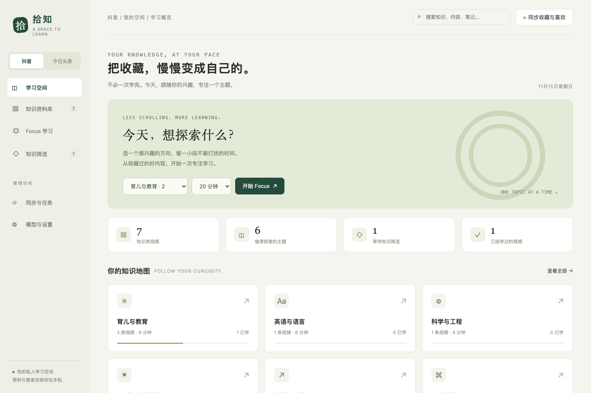
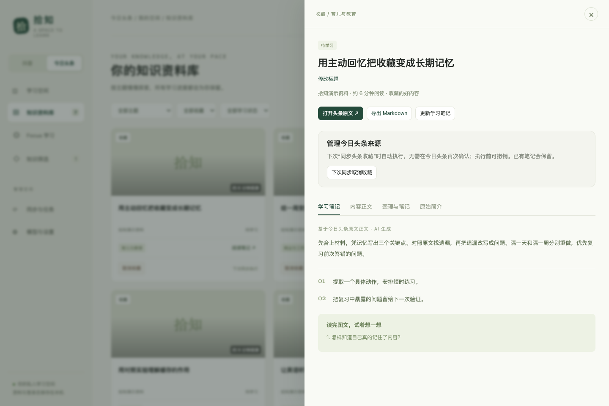

# 拾知 · 收藏学习工作台

把抖音和今日头条里收藏的内容整理成可以搜索、复习和导出的个人资料库。拾知运行在本机，可以从一篇文章或一条视频开始整理，也可以按主题和时间安排一次专注学习。



## 可以做什么

- **同步收藏**：抖音支持收藏和喜欢，今日头条支持收藏中的文章、微头条和视频。两个来源分别管理，支持完整扫描和增量同步。
- **筛选与分类**：按主题整理知识内容，排除非知识条目，无法确定的留待确认。可以手动修改主题和显示标题。
- **生成学习笔记**：基于文章正文、配图、视频字幕或音频转写，生成简体中文摘要、知识要点和复习题。
- **按需学习**：按主题和可用时间安排 Focus 队列，保存学习进度和自己的笔记。单篇内容可导出为 Markdown，知识库可导出为 JSON。
- **清理平台收藏**：在工作台标记要取消的收藏或喜欢，下次同步时执行，也可在执行前撤销。



## 快速开始

在 macOS 上准备 **Node.js 24 或更新版本**以及 **Microsoft Edge 或 Google Chrome**。如需更换浏览器位置，可设置环境变量 `FOCUS_BROWSER_PATH`。

```bash
git clone https://github.com/nanvtin-droid/shizhi-workbench.git
cd shizhi-workbench/app
npm ci
npm start
```

打开 [本机工作台](http://127.0.0.1:4317)。也可以从项目根目录双击 `启动拾知.command`。

1. 在侧栏选 **抖音** 或 **今日头条**，进入 **同步与任务**。第一次可选完整扫描，并在打开的专用浏览器里登录。
2. 在 **模型与设置** 填写兼容 Chat Completions 的 API 地址、模型和密钥。图文分析可开启支持图片输入的模型。
3. 在 **知识筛选** 确认要学习的内容，进入详情生成笔记，或在 **同步与任务** 运行批量整理。头条的 **全库筛选并生成知识笔记** 会逐条保存进度，可以暂停并按需继续。
4. 在 **知识资料库** 浏览主题和笔记，或进入 **Focus 学习** 安排学习队列。

视频会优先读取已有字幕。需要音频转写时，可以使用已配置的转写 API，也可以安装本机 Whisper。若选择本机转写，先安装 `uv`，再从 `app/` 运行：

```bash
./scripts/setup-asr.sh
```

## 数据与模型

工作台默认仅监听本机地址。SQLite、浏览器登录状态、API 设置和模型缓存存放在 `app/data/`。备份完整资料时，可在服务退出后复制此目录。

AI 整理会把所选内容的标题、正文及所需图片发送给配置的模型服务。只有配置在线转写时，音视频才会发送给转写服务。截图使用合成演示数据。

## 开发与测试

```bash
cd app
npm ci
npm test
```

`app/public/` 包含网页界面，`app/server.mjs` 提供本地 API，`app/lib/` 负责同步、存储、分类与内容读取。测试使用合成内容或本机测试服务，浏览器测试可使用本机安装的 Edge 或 Chrome。

本项目参考了 [douyin-collection-obsidian](https://github.com/hitahara-66/douyin-collection-obsidian) 的本地资料整理思路。第三方项目及许可证见 [许可说明](app/THIRD_PARTY_NOTICES.md)。
